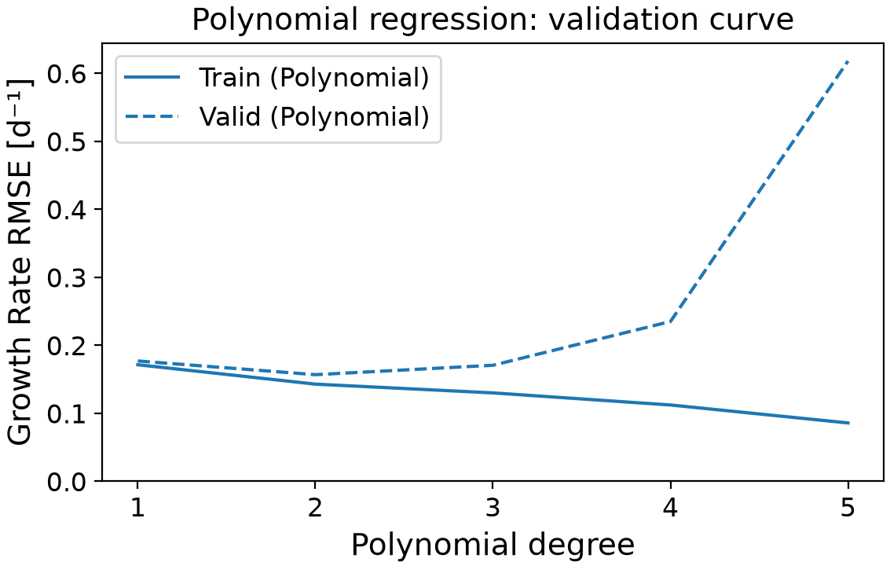
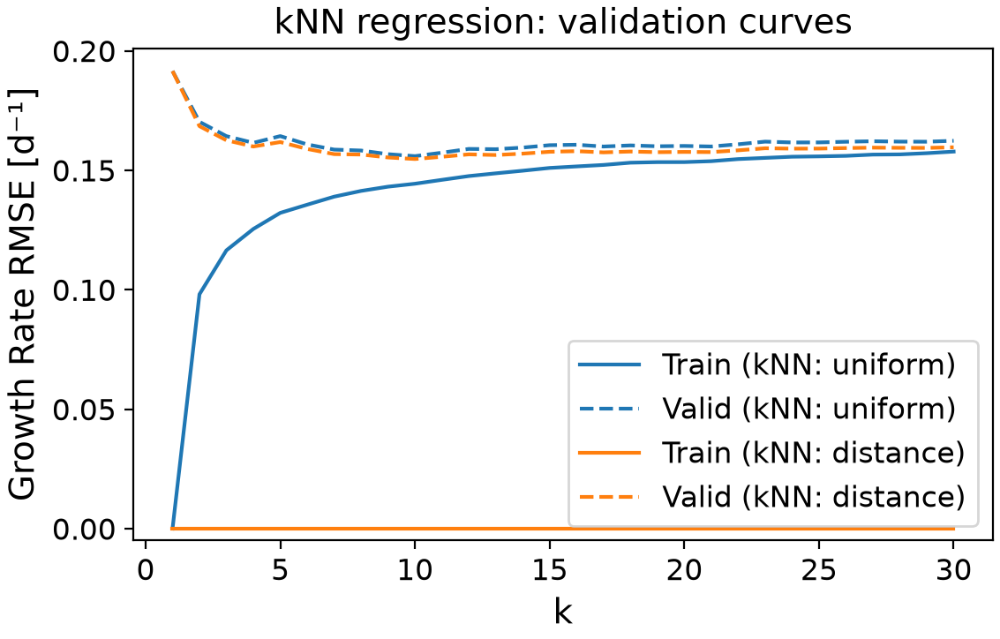

# Cell growth prediction using Machine Learning
This Python project predicts the specific growth rate of cells from temperature, pH, glucose concentration, and lactate concentration data. It compares linear regression, polynomial regression, and k-nearest neighbors regression using a simulated dataset. Cross-validation guides model selection, while a separate test set evaluates the selected model. The program exports tables and figures to support the comparison.

## Highlights

- Build regression pipelines for cell growth prediction.
- Scale culture variables within cross-validation pipelines.
- Optimize polynomial degree and kNN hyperparameters.
- Evaluate predictions using RMSE and R².
- Export validation curves and model comparison tables.

## Environment

- Python: 3.14.7
- Matplotlib: 3.11.0
- NumPy: 2.5.2
- pandas: 3.0.5
- scikit-learn: 1.9.0

## How to run

With Conda installed, download or clone this repository and open a terminal in the project folder. Run:

```bash
conda env create -f environment.yaml
conda activate chg4360c-fall2026
python main.py
```

If the environment already exists, skip the first command. The script prints model results and saves tables and figures in their respective folders.

## Code design

### 1- Data loading and variable selection
The workflow starts when main.py reads datasets/dataset_cell_growth_4factor.csv into a pandas DataFrame. The dataset contains 318 samples. The first column contains the target, specific growth rate in d⁻¹. The remaining columns contain the four features: temperature, pH, glucose concentration, and lactate concentration. The features and target are selected separately and converted to NumPy arrays.

### 2- Training and test split
The data are divided into a training set containing 80% of the observations and a test set containing 20%. Setting random_state = 0 makes the split reproducible.
The training set is used to fit and compare models and select hyperparameters. The test set is reserved for the final evaluation of the selected model.

### 3- Preprocessing and model pipelines
Each model is placed in a pipeline with StandardScaler. Scaling centers each input around its training mean and divides it by its training standard deviation. This step is essential for processing features at a comparable scale.

### 4- Setting and optimizing the models
Placing the scaler inside each pipeline ensures that it is fitted only on the training portion of each cross-validation fold. The validation observations are then transformed using those training statistics. The following models are implemented:
  - **Linear regression**: The program evaluates linear regression as the baseline using five-fold cross-validation on the training set. In each fold, the model is fitted on four parts and validated on the remaining part. Training and validation RMSE and R² are averaged across the five folds.
  - **Polynomial regression**: The pipeline includes an additional PolynomialFeatures term, which creates powers and interaction terms before linear regression is fitted. GridSearchCV is used to evaluate polynomial degrees from 1 to 5 using five-fold cross-validation. It records training and validation RMSE and R² for each degree, then selects the degree with the lowest mean validation RMSE. The program also extracts the intercept and weights of the best polynomial model. These weights help examine how individual inputs, squared terms, and interactions contribute to predicted growth.
  - **kNN regression**: GridSearchCV evaluates neighbor counts from 1 to 30 with both uniform and distance weighting, giving 60 configurations. Each configuration is evaluated using five-fold cross-validation. The program records training and validation RMSE and R², then selects the configuration with the lowest mean validation RMSE.

For all models, lower RMSE indicates smaller prediction errors, while higher R² indicates better performance relative to a mean-based prediction. The program reverses RMSE signs to positive values when reporting errors in the terminal and figures.

### 5- Final evaluation and code output
With refit="rmse", each search automatically refits its best pipeline on the full training set. The script then uses the selected model to assess the final performance of the reserved test set observations by determining RMSE and R2. For this dataset, kNN was selected as the optimal model fit, with a justification presented in the analysis below.
The program prints the main results and saves the search results in the tables directory. It also saves two PNG validation curves in the figures directory for:
  - **Polynomial regression**: [Polynomial degree vs  RMSE]
  - **kNN regression**: [Number_of_neighbors(k) vs RMSE] for both uniform and distance weighting.

## Analysis
The goal is to predict specific growth rate from four culture conditions. The dataset contains simulated data, so the results describe patterns in this dataset rather than a validated model for a particular cell line. The available ranges are the following:

|Variable                  |Minimum|Maximum|
|--------------------------|-------|-------|
|Temperature (°C)          |30.0   |42.0   |
|pH                        |6.00   |7.80   |
|Glucose (mM)              |0.0    |39.9   |
|Lactate (mM)              |0.0    |40.0   |
|Specific growth rate (d⁻¹)|0.000  |0.750  |

All models are compared using the same training set with five-fold cross-validation, and compare two performance metrics:
  - RMSE: expresses prediction error in the same units as growth rate and gives greater weight to larger errors.
  - R²: measures how much variation the model explains relative to a mean-based prediction.

Both metrics are needed because a model can improve on a baseline while still making errors that are too large for practical use.

### Comparison of different models
The table summarizes cross-validation results for each model. For polynomial regression and kNN, the reported configuration is the one with the lowest mean validation RMSE in its search.

|Model                     |        Configuration         |Mean training RMSE (d⁻¹) |Mean validation RMSE (d⁻¹)|Mean validation R²|
|--------------------------|------------------------------|------------------------|--------------------------|------------------|
|Linear regression         | Four scaled inputs           |0.171                   |0.177                     |0.007             |
|Polynomial regression     | Degree 2                     |0.143                   |0.157                     |0.185             |
|kNN regression            |10 neighbors, uniform weights |0.144                   |0.156                     |0.228             |
|kNN regression            |10 neighbors, distance weights|0.000                   |0.155                     |0.237             |

#### Linear regression:
The model has the highest validation RMSE among these configurations which indicates the highest prediction error. Its mean validation R² is also close to zero, indicating very limited predictive value. A linear model assumes a constant effect of each input when the others are held fixed. That assumption is restrictive for growth, where favorable conditions usually lie between low and high extremes.

#### Degree-2 polynomial regression:
This model improved validation RMSE to approximately 0.157 d⁻¹. Its validation R² of 0.185 also indicates an improvement over the linear model, although predictive performance remains limited. With four original inputs, degree 2 generates 14 polynomial features, excluding the intercept. This adds flexibility while keeping the model relatively small. Squared terms allow curvature, with pH² having the largest coefficient magnitude (−0.061), followed by temperature² (−0.020). Both coefficients are negative, indicating downward curvature in predicted growth. Interaction terms, particularly glucose × lactate and temperature × pH, also contribute to predictions, allowing the effect of one variable to depend on another.

   
 

Figure 1. Training and validation RMSE as polynomial degree increases.

The polynomial validation curve shows why the most complex model is not selected. Mean validation RMSE falls from 0.177 d⁻¹ at degree 1 to 0.157 d⁻¹ at degree 2. It then rises to 0.171, 0.235, and 0.618 d⁻¹ for degrees 3, 4, and 5, respectively.
Training RMSE continues to decrease as degree increases. This growing gap indicates overfitting: the higher-degree models fit the training observations more closely but predict validation observations less accurately. Degree 2 gives the best validation performance within the tested polynomial range.

#### kNN model:
The fitted model with 10 neighbors and distance weighting has the lowest mean validation RMSE, approximately 0.155 d⁻¹. This model enables the prediction of growth from nearby observations in the scaled input space, without requiring a specific equation for the relationship between culture conditions and growth. This model had the highest R² value from the tested model, but it still explained only 23.7% of the variation in growth rate, indicating limited predictive performance.
From the 3 models tested, kNN achieved the lowest mean cross-validation RMSE. However, the advantage over degree-2 polynomial regression is small: approximately 0.002 d⁻¹ in RMSE. The fold-to-fold standard deviations in validation RMSE are approximately 0.011 d⁻¹ for the selected kNN model and 0.016 d⁻¹ for degree-2 regression. These values do not establish statistical significance. Therefore, degree-2 regression remains a reasonable alternative, especially when a fitted equation is useful.

  

Figure 2. Training and validation RMSE for uniform and distance weighting across neighbor counts.

A small neighbor count makes predictions sensitive to a few nearby observations, while a count that is too large averages over more observations and smooth out useful local patterns. Ten neighbors provides the best balance among the tested configurations for this split and cross-validation setup.
Distance-weighted kNN has zero training RMSE here because a training observation is its own neighbor at zero distance. When predicting that same observation, the estimator returns its measured target. Therefore, zero training error does not show that the model will predict new observations perfectly. Validation performance provides the useful evidence for choosing its hyperparameters.
Uniform weighting with 10 neighbors gives a similar validation RMSE of approximately 0.156 d⁻¹. Distance weighting is selected because it has a slightly lower error, but both approaches are reasonable.

### Final test performance
The selected kNN model refitted on training observations and evaluated on test observations resulted in the following performance metrics:
| Metric     | Value |
|------------|-------|
| RMSE (d⁻¹) | 0.156 |
| R²         | 0.394 |

- The test RMSE is close to the mean validation RMSE, which is encouraging for this split. However, an error of around 0.156 d⁻¹ is substantial compared with the dataset's mean growth rate of approximately 0.283 d⁻¹. The test R² indicates that the model explains about 39% of the variation in test growth rates. Its predictive ability is useful but limited.
- Test R² is higher than mean validation R². These scores use different observations and different reference variation, so they do not have to match. One favorable test split does not establish strong general performance. Repeating the evaluation with other splits or an independent dataset would provide stronger evidence.

### Culture conditions and prediction reliability
The polynomial fit suggests that higher growth is favored by intermediate temperature and pH, while higher glucose and lower lactate concentrations contribute positively near the average culture conditions. Lower growth is expected at unfavorable temperature or pH values, or when low glucose and high lactate occur together. However, interactions mean that the effect of each variable depends on the other conditions, so these trends do not establish exact optimal values.
For the selected kNN model, predictions are less reliable for combinations with few nearby training observations, even when each input is within the dataset’s range. Predictions outside the studied ranges are particularly unreliable because kNN relies on existing neighbors and cannot extrapolate trends.

### Model advantages and limitations
The model could help with early screening by providing rough growth estimates and helping prioritize culture conditions for experiments. The workflow’s strengths are its reproducible split, scaling within pipelines, consistent cross-validation, and separate test evaluation. Its main limitations are the small simulated dataset and limited predictive accuracy. These limitations make it a starting point for process investigation, with additional data and validation in the intended culture system needed before using its predictions to guide operating decisions.
